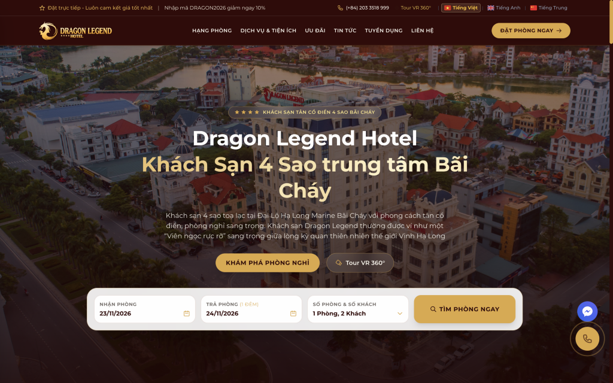
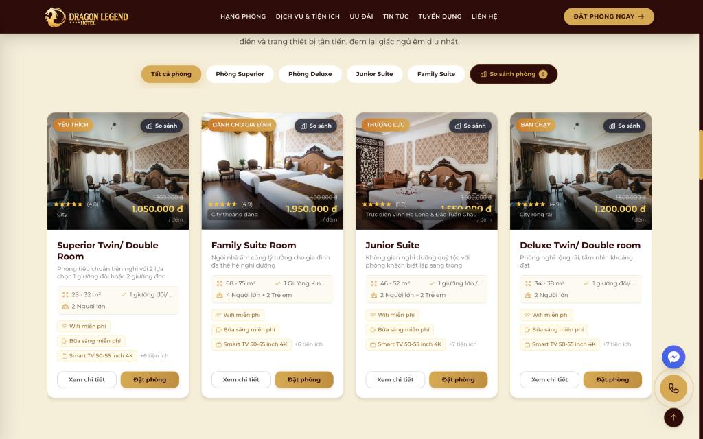
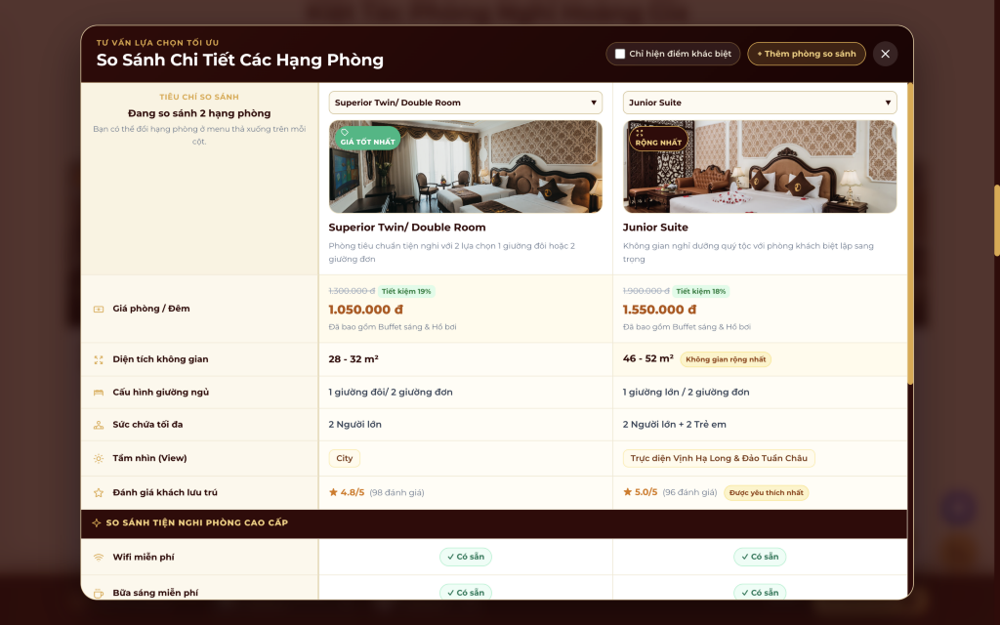
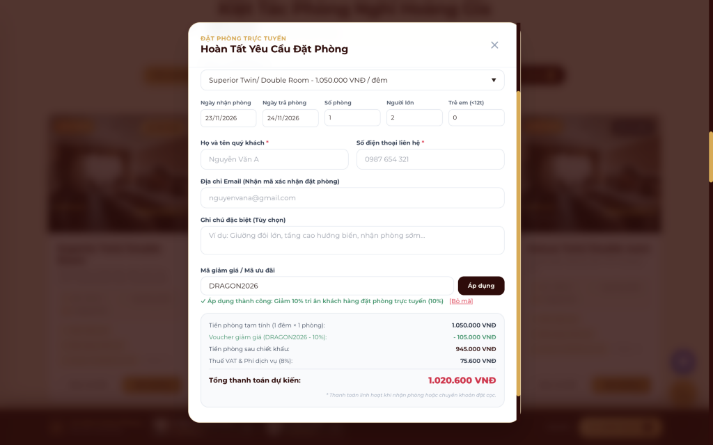
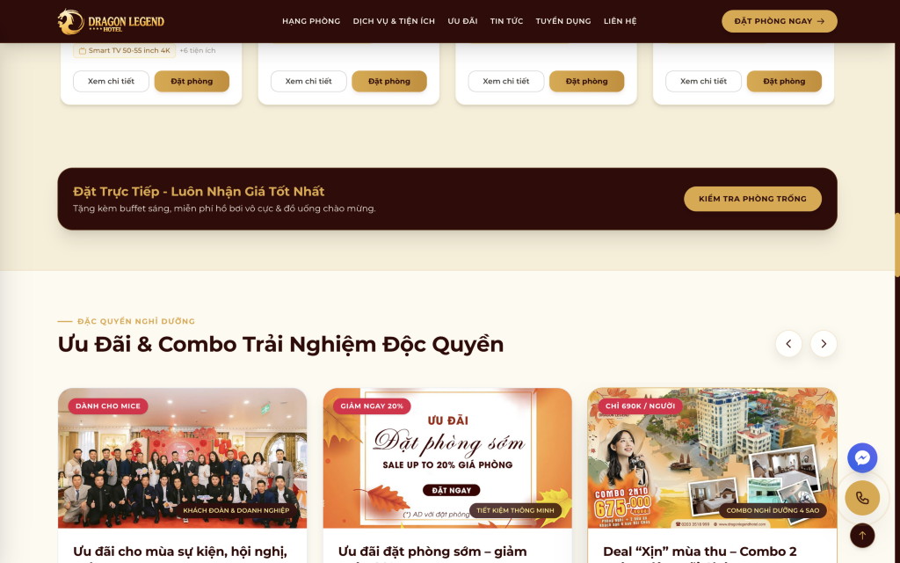
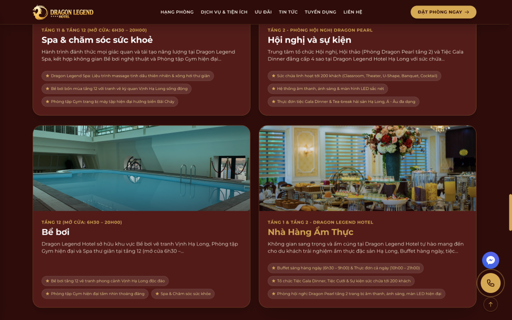
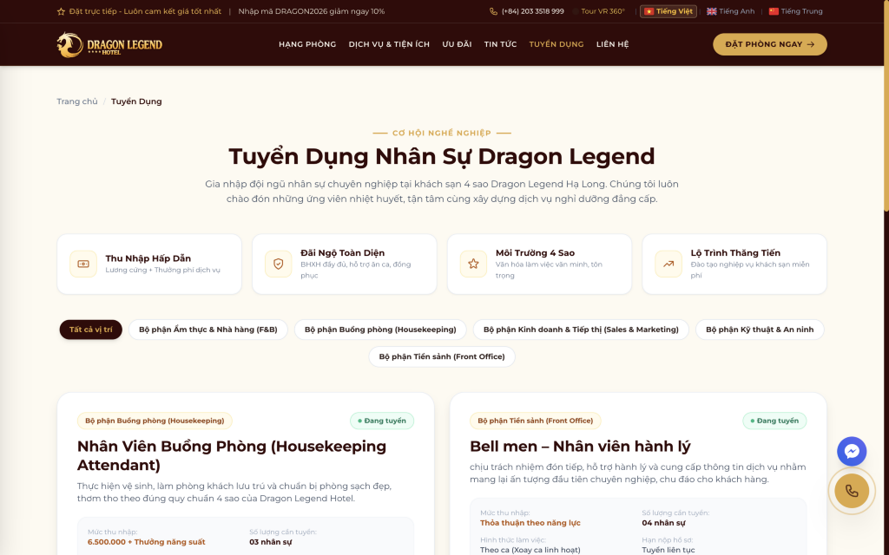
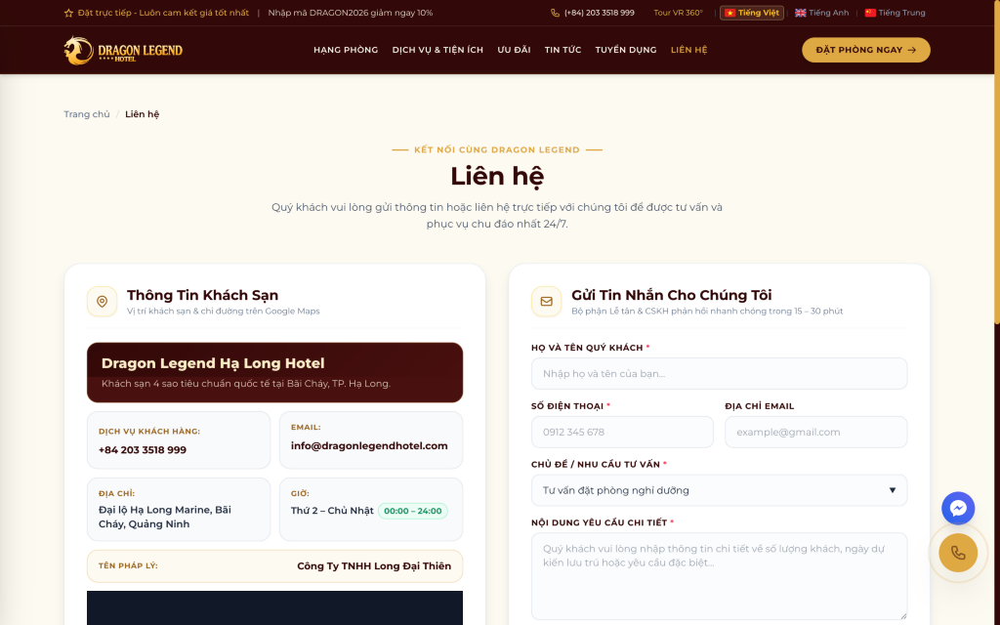

f# Dragon Legend Hotel Hạ Long — Hệ Thống Website & Đặt Phòng Khách Sạn 4 Sao

Website chính thức của **Dragon Legend Hotel Hạ Long** ([https://dragonlegendhotel.com](https://dragonlegendhotel.com)) — Khách sạn 4 sao phong cách Tân Cổ Điển tọa lạc tại trung tâm Đại lộ Hạ Long Marine, Bãi Cháy, TP. Hạ Long, Quảng Ninh.

Hệ thống được thiết kế và phát triển chuyên biệt trên nền tảng **WordPress** với kiến trúc phân tách rõ ràng giữa **Giao diện hiển thị (`themes/dragonlegend`)** và **Hệ sinh thái Plugin nghiệp vụ (`plugins/dragonlegend-*`, `plugins/tuyen-dung`)**, tối ưu tốc độ tải trang (Inline Tailwind CSS Bundle, Zero jQuery Dependency), chuẩn SEO Schema 4 Sao & tích hợp Đặt phòng trực tuyến thời gian thực.

---

## 📸 Hình Ảnh Giao Diện & Mô Tả Chi Tiết Các Chức Năng Website

### 1. Trang Chủ (Hero Banner), Thanh Topbar Đa Ngôn Ngữ & Thanh Tìm Phòng Nhanh


- **Thanh Topbar Thông Minh**:
  - Hiển thị thông điệp ưu đãi đặt phòng trực tiếp (`Nhập mã DRAGON2026 giảm ngay 10%`).
  - Liên kết gọi nhanh **Hotline 24/7**: `(+84) 203 3518 999`.
  - Nút mở nhanh **Tour Thực Tế Ảo VR 360°** giúp du khách tham quan không gian khách sạn trực quan.
  - **Bộ chuyển đổi ngôn ngữ tự động (`Dragon Legend Auto Translator`)**: Hỗ trợ 3 ngôn ngữ **Tiếng Việt (`🇻🇳`) — Tiếng Anh (`🇬🇧`) — Tiếng Trung (`🇨🇳`)**, tự động đồng bộ nhãn ngôn ngữ theo phiên người dùng và bảo toàn 100% URL chuẩn SEO cho Googlebot.
- **Hero Banner & Quick Booking Bar**:
  - Cho phép du khách chọn nhanh **Ngày nhận phòng**, **Ngày trả phòng** (tự động tính số đêm lưu trú), **Số lượng phòng & Số khách (Người lớn / Trẻ em)** và bấm **Tìm phòng ngay** để mở thẳng biểu mẫu đặt phòng với dữ liệu đã chọn.

---

### 2. Hệ Thống Hạng Phòng (`dl_room`) & Bộ Lọc Phân Loại Phòng Động (`dl_room_type`)


- **Quản lý động 100% từ Cơ sở dữ liệu**:
  - Danh sách các loại phòng (*Phòng Superior, Phòng Deluxe, Junior Suite, Family Suite...*) được truy vấn trực tiếp từ Taxonomy `dl_room_type` và Custom Post Type `dl_room`.
  - Hỗ trợ đồng bộ giao diện hiển thị trên cả trang chủ, trang danh sách tổng hợp (`/phong-nghi/`) và các trang lưu trữ từng phân loại phòng (`/loai-phong/phong-deluxe/`, `/loai-phong/phong-superior/`...).
- **Thông tin thẻ phòng trực quan**:
  - Hiển thị huy hiệu nổi bật (*Yêu thích, Dành cho gia đình, Thượng lưu, Bán chạy*), điểm đánh giá sao, hướng nhìn (*City View, Trực diện Vịnh Hạ Long & Đảo Tuần Châu*), giá ưu đãi/đêm kèm giá gốc gạch ngang.
  - Liệt kê diện tích phòng (`m²`), cấu hình giường ngủ, sức chứa tối đa và các tiện nghi tiêu chuẩn (*Wifi miễn phí, Bữa sáng miễn phí, Smart TV 50-55 inch 4K, Bồn tắm nằm...*).

---

### 3. Chức Năng So Sánh Chi Tiết Các Hạng Phòng (Room Comparison)


- **So sánh trực quan từ 2 đến 4 hạng phòng cùng lúc**:
  - Du khách bấm nút **`So sánh`** trên từng thẻ phòng để thêm vào thanh công cụ so sánh nổi dưới đáy màn hình.
  - Bảng so sánh đối chiếu chi tiết từng tiêu chí: **Giá phòng/đêm & mức tiết kiệm**, **Diện tích không gian**, **Cấu hình giường ngủ**, **Sức chứa tối đa**, **Tầm nhìn (View)**, **Điểm đánh giá lưu trú** và **Danh sách từng tiện nghi cao cấp**.
  - Tích hợp bộ lọc **`Chỉ hiện điểm khác biệt`** và menu thả xuống cho phép đổi nhanh hạng phòng ngay trong từng cột so sánh.

---

### 4. Đặt Phòng Trực Tuyến (AJAX Booking Engine) & Tính Toán Voucher / Thuế VAT


- **Tính toán chi phí tự động theo thời gian thực (`booking.js`)**:
  - Tự động cập nhật tổng tiền ngay khi khách thay đổi hạng phòng, ngày nhận/trả phòng, số lượng phòng hoặc nhập/xóa mã ưu đãi.
  - **Công thức tính khi chưa có Voucher**:
    - `Tiền phòng tạm tính = Giá phòng/đêm × Số đêm × Số phòng`
    - `Thuế VAT & Phí dịch vụ (8%) = Tiền phòng tạm tính × 8%`
    - `Tổng thanh toán dự kiến = Tiền phòng tạm tính + 8% VAT & Phí dịch vụ`
  - **Công thức tính khi áp dụng Voucher (`Dragon Legend Coupons`)**:
    - Hỗ trợ cả **Voucher giảm theo phần trăm (`%`)** (có kiểm tra mức giảm tối đa `max_discount`) và **Voucher giảm tiền mặt cố định (`VNĐ`)** (có kiểm tra giá trị đơn tối thiểu `min_spend` và giới hạn theo hạng phòng).
    - `Tiền phòng sau chiết khấu = Tiền phòng tạm tính - Voucher giảm giá`
    - `Thuế VAT & Phí dịch vụ (8%) = Tiền phòng sau chiết khấu × 8%`
    - `Tổng thanh toán dự kiến = Tiền phòng sau chiết khấu + 8% VAT & Phí dịch vụ`
- **Tự động hóa quy trình tiếp nhận đơn (`dl_booking`)**:
  - Sinh mã đặt phòng định danh duy nhất (`DLH-XXXXXX`) và lưu vào hệ thống quản trị WP-Admin.
  - Tự động gửi thông báo đơn đặt phòng mới qua **Email HTML cao cấp**, **Telegram Bot** và **Zalo OA / ZNS** cho bộ phận Lễ tân & khách hàng.
  - Tích hợp sẵn sự kiện đo lường chuyển đổi **Google Analytics 4 (`purchase` & `generate_lead`)**.

---

### 5. Gói Ưu Đãi & Combo Nghỉ Dưỡng Độc Quyền (`dl_offer`)


- Quản lý và trình bày các chương trình khuyến mãi theo mùa, gói Combo nghỉ dưỡng 2N1Đ, ưu đãi đặt phòng sớm (*Early Bird giảm 20%*) và gói hội nghị/sự kiện doanh nghiệp (*Combo MICE & Gala Dinner*).
- Mỗi gói hiển thị rõ danh sách quyền lợi đi kèm, điều kiện áp dụng, mức giá ưu đãi và nút **`Nhận ưu đãi`** kết nối trực tiếp với biểu mẫu đặt phòng.

---

### 6. Hệ Thống Dịch Vụ & Tiện Ích Chuẩn 4 Sao (`dl_amenity`)


- Trình bày nổi bật hệ sinh thái dịch vụ nội khu của khách sạn:
  - **Spa & Chăm sóc sức khỏe** (Tầng 11 & Tầng 12): Liệu trình massage tinh dầu thiên nhiên & xông hơi thư giãn.
  - **Hội nghị & Sự kiện — Phòng Hội Nghị Dragon Pearl** (Tầng 2): Sức chứa tới 200 khách, âm thanh ánh sáng & màn hình LED chuẩn quốc tế.
  - **Bể bơi bốn mùa & Phòng tập Gym** (Tầng 12): Bể bơi nghệ thuật vẽ tranh kỳ quan Vịnh Hạ Long cùng phòng Gym hướng biển.
  - **Nhà hàng Ẩm thực** (Tầng 1 & Tầng 2): Buffet sáng Á - Âu hàng ngày và thực đơn hải sản Hạ Long đặc sắc.

---

### 7. Hệ Thống Tuyển Dụng Nhân Sự (`tuyen-dung`)


- **Chuẩn hóa URL SEO & Phân loại bộ phận (`bo_phan_tuyen_dung`)**:
  - Đồng nhất đường dẫn danh mục bộ phận theo cấu trúc chuẩn `/bo-phan-tuyen-dung/<slug>/` (*Bộ phận Ẩm thực & Nhà hàng F&B, Buồng phòng Housekeeping, Kinh doanh & Tiếp thị, Kỹ thuật & An ninh, Tiền sảnh Front Office*), tự động chuyển hướng `301` từ các tham số truy vấn cũ.
- **Ứng tuyển trực tuyến**:
  - Hiển thị mức thu nhập, số lượng cần tuyển, hạn nộp hồ sơ, mô tả công việc và biểu mẫu nộp hồ sơ trực tuyến kèm thông báo tức thì cho phòng Nhân sự (HR) qua Email/Telegram/Zalo.

---

### 8. Trang Liên Hệ, Bản Đồ Định Vị & Tư Vấn 24/7 (`/lien-he/`)


- Hiển thị đầy đủ thông tin liên hệ chính thức, pháp nhân khách sạn (**Công Ty TNHH Long Đại Thiên**), khoảng cách kết nối từ khách sạn tới các điểm du lịch nổi tiếng (*Sun World Hạ Long Complex, Bãi tắm Bãi Cháy, Chợ đêm Hạ Long, Cảng tàu khách quốc tế*).
- Tích hợp bản đồ **Google Maps** tương tác và biểu mẫu gửi tin nhắn tư vấn trực tuyến 24/7.

---

## 🏗️ Kiến Trúc Thư Mục Dự Án

```text
DragonLegendHotel/
├── docs/
│   └── screenshots/                        # Hình ảnh chụp thực tế các chức năng website
├── wp-content/
│   ├── themes/
│   │   └── dragonlegend/                   # Custom Theme Dragon Legend Hotel
│   │       ├── assets/
│   │       │   ├── css/                    # Tailwind CSS Bundle (bundle.min.css) & Custom CSS
│   │       │   └── js/                     # Vanilla JS Booking Engine (booking.js) & Main UI (main.js)
│   │       ├── front-page.php              # Giao diện Trang chủ động
│   │       ├── archive-dl_room.php         # Trang danh sách tất cả hạng phòng (/phong-nghi/)
│   │       ├── taxonomy-dl_room_type.php   # Trang lưu trữ theo từng Loại phòng (/loai-phong/*)
│   │       ├── single-dl_room.php          # Trang chi tiết hạng phòng
│   │       ├── single-dl_offer.php         # Trang chi tiết gói ưu đãi & combo
│   │       ├── page-lien-he.php            # Trang Liên hệ & Bản đồ Google Maps
│   │       ├── header.php                  # Topbar, Điều hướng, Schema JSON-LD Hotel 4 Sao
│   │       ├── footer.php                  # Footer, Modal Đặt phòng trực tuyến, Modal So sánh phòng
│   │       └── functions.php               # Core helpers, SEO Sitemap/llms.txt self-healing, Rest/AJAX
│   └── plugins/
│       ├── dragonlegend-core/              # Quản lý CPTs (Phòng, Đơn đặt phòng, Ưu đãi, Dịch vụ, Đánh giá), Email/Zalo/Telegram
│       ├── dragonlegend-coupons/           # Quản lý Mã giảm giá / Voucher (% & VNĐ, giới hạn phòng, đơn tối thiểu)
│       ├── dragonlegend-content-manager/   # Quản lý Nội dung tĩnh, Cấu hình Trang chủ, Liên hệ & Mã đo lường GA4/GTM
│       ├── dragonlegend-translator/        # Chuyển đổi ngôn ngữ tự động (Việt - Anh - Trung) bảo toàn SEO
│       ├── dragonlegend-unicorn-admin/     # Tùy biến giao diện Quản trị WP-Admin & Trang đăng nhập thương hiệu
│       ├── dragonlegend-search-replace/    # Công cụ đồng bộ tên miền & dữ liệu an toàn
│       └── tuyen-dung/                     # Hệ thống Tuyển dụng nhân sự & Tiếp nhận hồ sơ ứng viên
├── wp-config.php                           # Cấu hình WordPress (đã ẩn toàn bộ khóa mật khẩu & API Keys qua biến môi trường)
├── start-server.sh / stop-server.sh        # Script khởi động nhanh môi trường phát triển cục bộ
└── HUONG_DAN_SU_DUNG_VA_MO_RONG.md         # Tài liệu hướng dẫn quản trị & mở rộng dành cho lập trình viên
```

---

## 🔒 Bảo Mật & Các Thông Tin Đã Được Ẩn / Loại Trừ

Khi đưa mã nguồn lên GitHub, hệ thống đã được cấu hình [`.gitignore`](.gitignore) và làm sạch dữ liệu nhạy cảm:
- **Ẩn thông tin xác thực trong [`wp-config.php`](wp-config.php)**:
  - Toàn bộ khóa bảo mật WordPress (`AUTH_KEY`, `SECURE_AUTH_KEY`, `LOGGED_IN_KEY`, `NONCE_KEY` & `SALT`) được chuyển sang đọc từ biến môi trường `getenv()`.
  - Khóa kết nối **Cloudflare R2 (`ADVMO_CLOUDFLARE_R2_KEY`, `ADVMO_CLOUDFLARE_R2_SECRET`, `ADVMO_CLOUDFLARE_R2_ENDPOINT`)** và mật khẩu cơ sở dữ liệu thực tế đã được ẩn hoàn toàn.
  - Các token **Telegram Bot**, **Zalo OA Access Token** và **Mật khẩu SMTP** được lưu trong cơ sở dữ liệu (không lưu cứng trong mã nguồn).

---

## 🚀 Hướng Dẫn Cài Đặt & Khởi Chạy

1. **Sao chép mã nguồn (Clone Repository)**:
   ```bash
   git clone https://github.com/fbaduongth/dragonlegendhotel.git
   cd dragonlegendhotel
   ```
2. **Cấu hình môi trường**:
   - Cập nhật thông tin kết nối MySQL (`DB_NAME`, `DB_USER`, `DB_PASSWORD`, `DB_HOST`) hoặc biến môi trường trong `wp-config.php`.
   - Khai báo khóa Cloudflare R2 (nếu sử dụng tính năng đồng bộ Media R2) thông qua biến môi trường `ADVMO_CLOUDFLARE_R2_KEY` và `ADVMO_CLOUDFLARE_R2_SECRET`.
3. **Kích hoạt Theme & Plugins**:
   - Kích hoạt giao diện **Dragon Legend Hotel** (`dragonlegend`).
   - Kích hoạt bộ plugin nghiệp vụ: `Dragon Legend Core`, `Dragon Legend Coupons`, `Dragon Legend Content Manager`, `Dragon Legend Auto Translator`, `Dragon Legend Unicorn Admin` và `Tuyển Dụng`.
   - Vào **Cài đặt $\rightarrow$ Đường dẫn tĩnh (Permalinks)** và bấm **Lưu thay đổi** để khởi tạo quy tắc URL chuẩn cho Hạng phòng, Loại phòng và Tuyển dụng.
